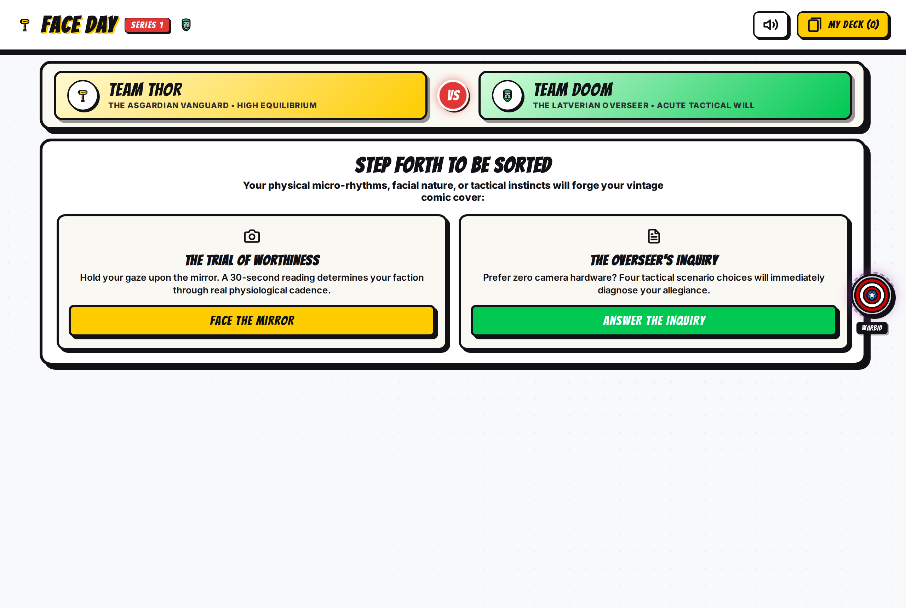
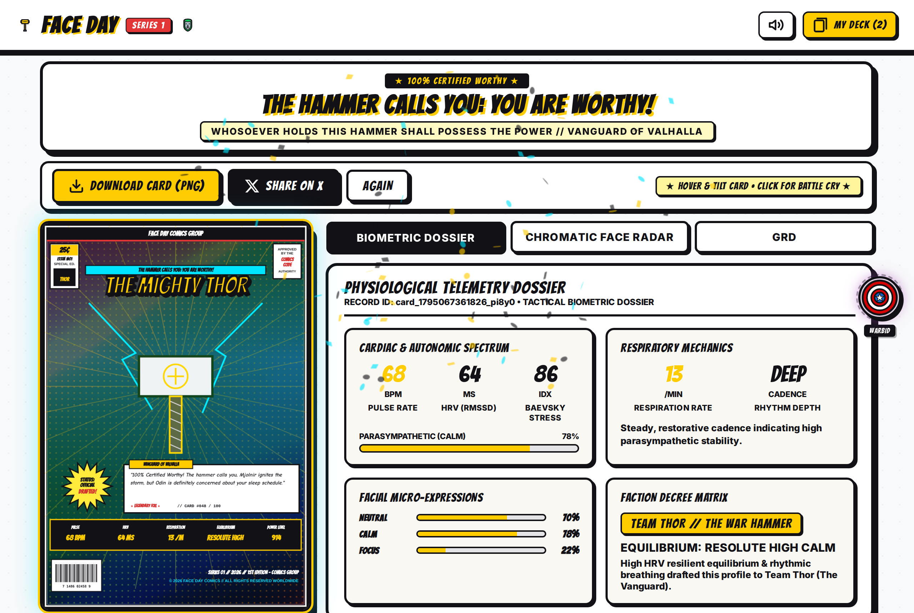
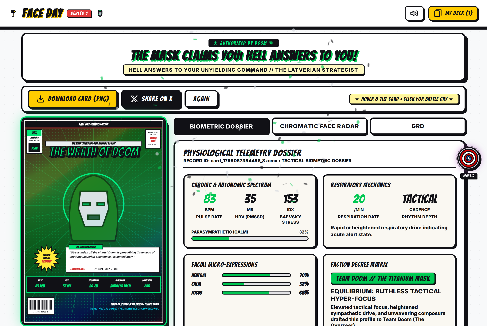
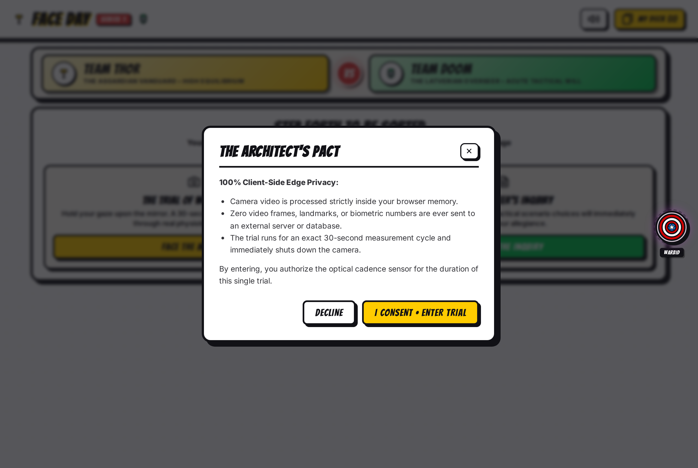
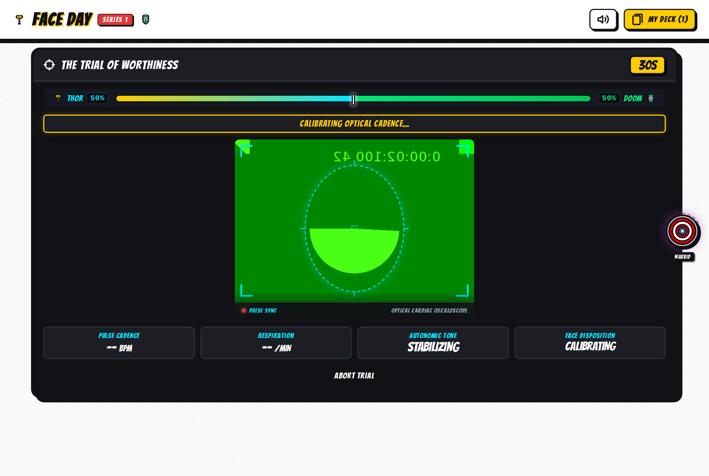
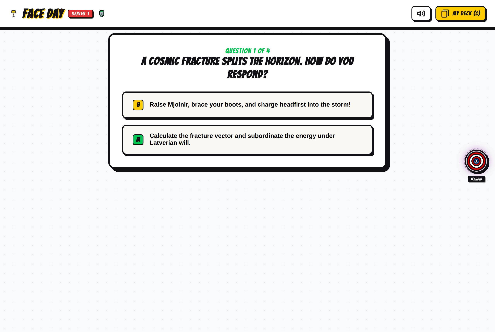
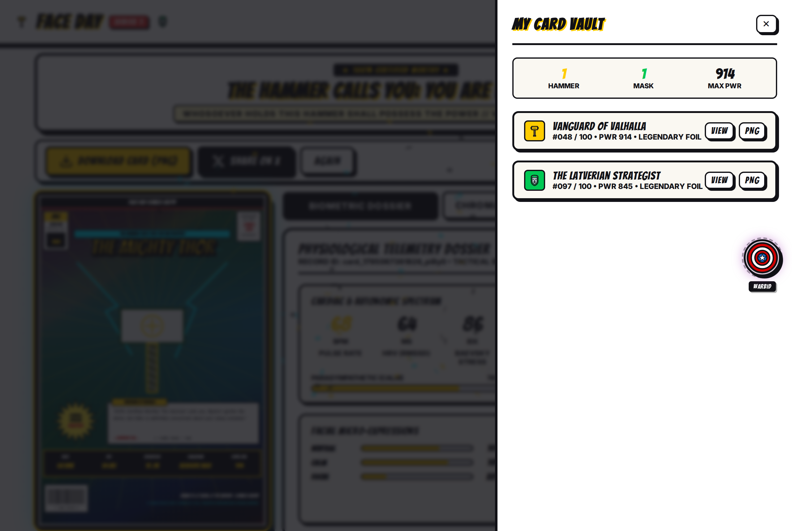

# FACE DAY: THE BIOMETRIC BATTLEGROUND
> **Issue #001 &bull; Fall of the Sovereign &bull; An Edge-Powered Comic Trading Card Game**
> 
> *Created for the Presage SmartSpectra SDK Challenge on DEV Community (Creativity Track).*

---



---

## The Concept

In vintage comic lore, destiny is never chosen—it is revealed. 

**Face Day** transforms contactless facial sensing into a physical retro comic trading card battleground. Instead of sterile medical dashboards or clinical heart-rate graphs, your real physiological cadence, facial expressions, and tactical instincts forge an authentic, collectible trading card drafting you into one of two legendary factions:

* **TEAM THOR (The Asgardian Vanguard):** Powered by deep parasympathetic calm, resilient cardiac variability, and unshakeable fortitude. Bearing the **War Hammer (Mjolnir)** in Celestial Gold and Lightning Azure.
* **TEAM DOOM (The Latverian Overseer):** Powered by acute sympathetic focus, tactical composure under pressure, and relentless iron willpower. Bearing the **Iron Mask** in Emerald Green and Titanium Steel.

Every completed trial renders an authentic **Physical Trading Card** with dynamic foil shimmer, unique collector numbers (`#001/050`), rarity grades, and RPG combat stats (*Agility, Endurance, Focus, Willpower*).

---

## Minted Trading Cards

| Team Thor &bull; The Asgardian Vanguard | Team Doom &bull; The Latverian Overseer |
| :---: | :---: |
|  |  |
| *High Calm &bull; Resilient Cadence &bull; Legendary Foil* | *Acute Focus &bull; Tactical Will &bull; Ultra-Rare Foil* |

---

## The Game Experience

### 1. The Chamber of Decision & Consent Gate
Before any trial begins, players are presented with an explicit, vintage comic consent gate. 



* **100% Client-Side:** Video frames are analyzed in local runtime memory. Zero video or photographic data is ever recorded, stored, or transmitted over the wire.
* **Two Playable Paths:** Players can enter via the live camera mirror or bypass directly into the tactical scenario inquiry.

---

### 2. Path A: The Trial of Worthiness (Live Camera HUD)
Step before the mirror for a 30-second assessment. 



* **Comic Reticle & Dynamic Resonance:** The live camera HUD tracks your face within an inked targeting frame. The **Asgardian vs Latverian Resonance Gauge** shifts in real time between Thor (Azure) and Doom (Emerald) as your micro-signals fluctuate.
* **Live Cardiac Oscilloscope:** A vintage cathode-ray CRT wave displays real-time pulse cadence alongside breath cadence and facial expression classifications.
* **Strict 30-Second Watchdog:** The session automatically concludes at second 30, preserving API credits while collecting sufficient cadence data.

---

### 3. Path B: The Overseer's Inquiry (Tactical Quiz Bypass)
For players on devices without a webcam or who prefer pure tactical decision-making.



* Four high-stakes tactical comic scenarios diagnose your moral alignment, instinct under fire, and faction allegiance.
* Immediate calculation into the sorting engine with custom RPG stats.

---

### 4. The Decree & The Collector's Vault
Upon trial completion, procedural Web Audio fanfare erupts (Asgardian thunder crash for Thor, heavy metallic resonance for Doom), minting your card directly onto an HTML5 canvas.



* **1-Click Download:** Export a high-resolution 750×1050 PNG ready for print or digital collection.
* **Share on X:** Instant social sharing intent with your minted faction and archetype.
* **The Deck Vault:** All your previously minted cards are automatically cataloged in your offline browser vault (`localStorage`), letting you inspect past draws, track faction balances, and build your deck.

---

## Visual Design System

Face Day strictly adheres to a handcrafted retro comic book aesthetic:
* **Inked Linework:** 2px to 4px solid `#111116` borders with offset drop shadows (`4px 4px 0 #111116`).
* **Ben-Day Halftones:** Custom SVG dot patterns and action burst starbursts.
* **Paper Textures:** Parchment undertones (`#F8F9FA` to `#FBF8EE`) evocative of classic newsprint comic panels.
* **Zero Pictorial Emojis:** Strict prohibition on modern emoji characters in the UI. All emblems are custom vector SVGs (Mjolnir war hammer, Latverian iron mask, Captain America vibranium shield, targeting reticle, action bursts).
* **Typography:** Vintage comic display typography (`Bangers`, `Comic Neue`, `Inter`).

---

## Quickstart

### 1. Run the Frontend Locally
```bash
# Clone the repository
git clone https://github.com/Viswesh934/Face-Day.git
cd Face-Day

# Install dependencies
npm install

# Start Vite dev server
npm run dev
```
Open [http://localhost:5173](http://localhost:5173) in your browser.

---

### 2. Run the Presage SmartSpectra Backend
To power the live camera trial with genuine Presage SmartSpectra C++ biometrics:

```bash
# Set your API Key from the Presage Developer Portal
export SMARTSPECTRA_API_KEY="your-presage-api-key"

# Start the dedicated WebSocket server
npm run backend
```
The backend initializes the native SDK (`@smartspectra/node-sdk`) on port `8765`, listening for WebSocket camera streams and exposing health telemetry on `/health`.

---

### 3. Deploy Fullstack to Zerops
Face Day includes a turnkey [zerops.yml](zerops.yml) configuration that deploys both the Ubuntu C++ Node.js backend container and the static Nginx frontend bundle in a single repository:

* Read the complete deployment guide: [Zerops Fullstack Deployment Guide](docs/ZEROPS_DEPLOYMENT.md).

---

## Submission Details

* **Event:** Presage SmartSpectra SDK Challenge on DEV Community
* **Category:** Creativity Track
* **Core Technologies:** Presage SmartSpectra SDK (`@smartspectra/node-sdk`), TypeScript, Vite, Web Audio API, HTML5 Canvas 2D, Zerops
* **License:** MIT
