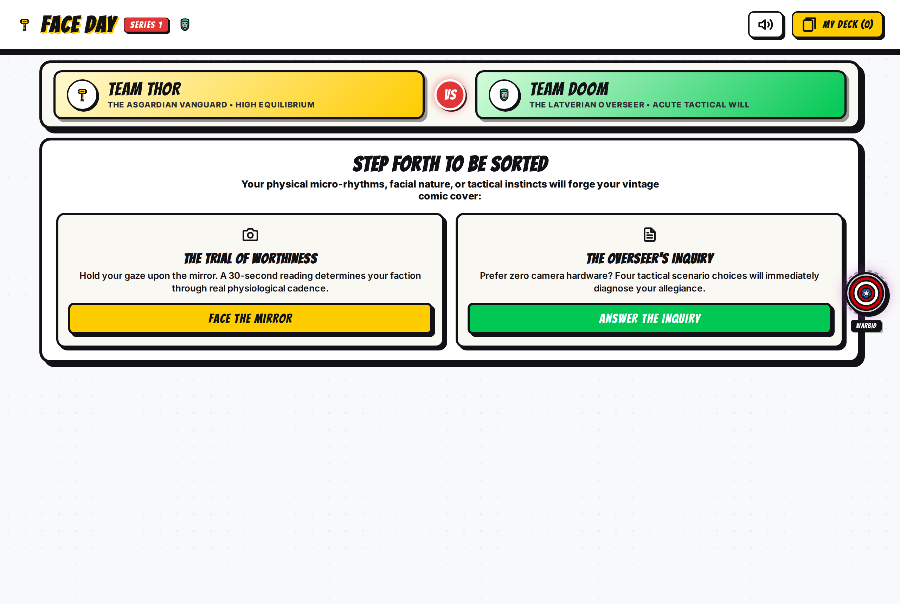
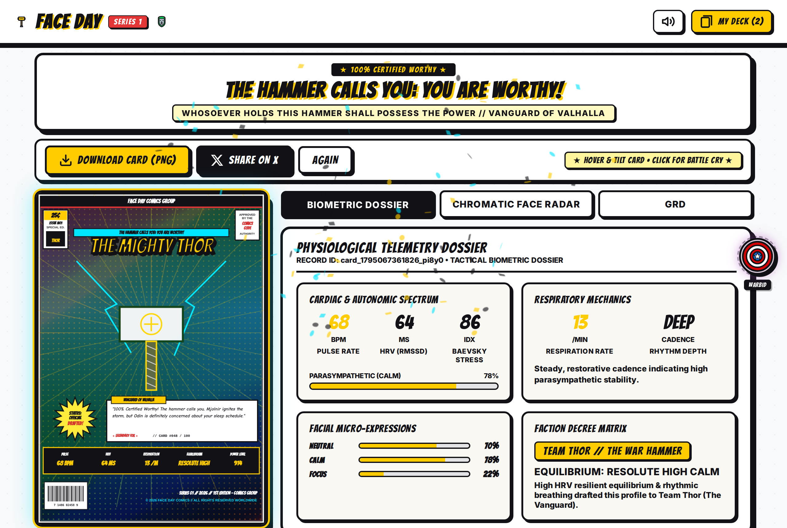
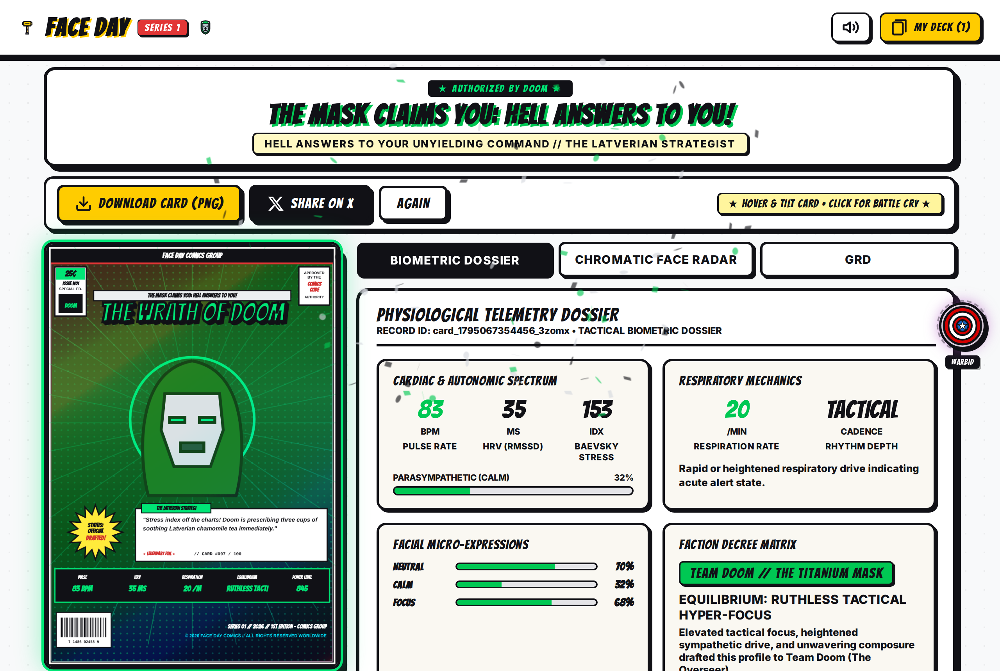
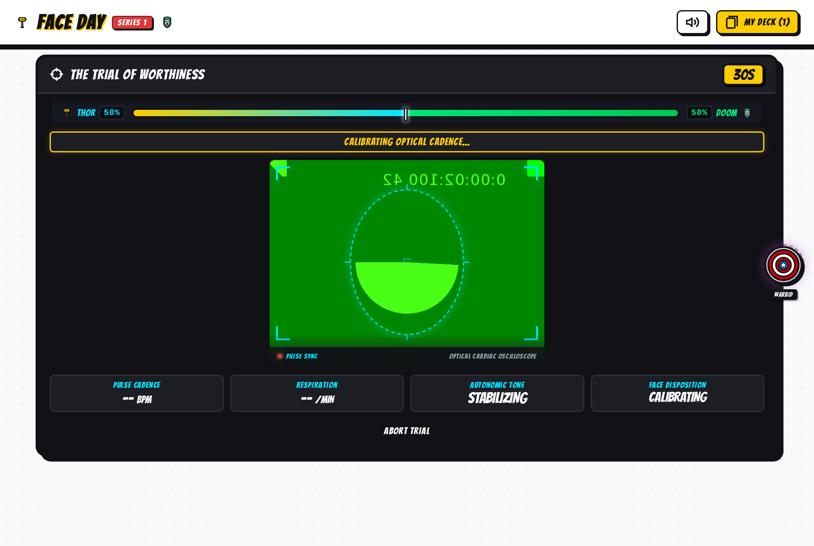
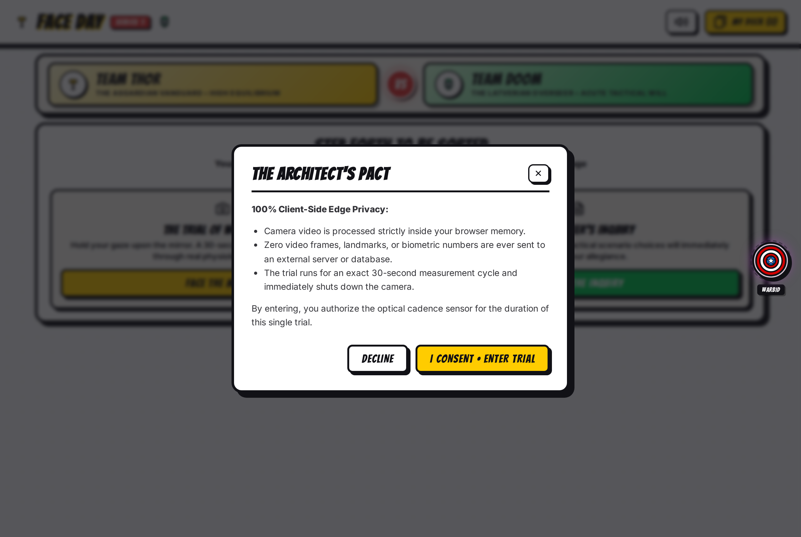
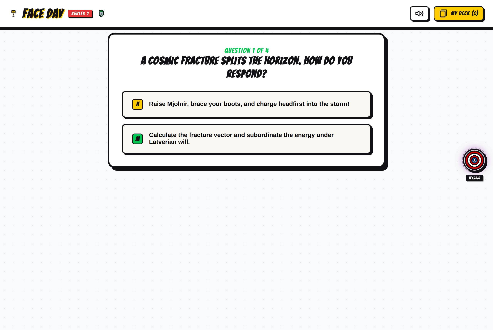
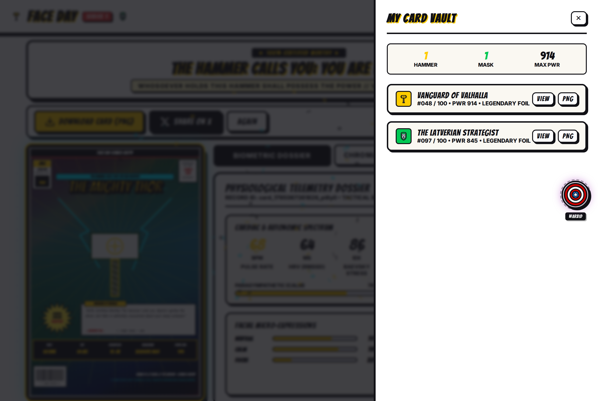

# Face Day: The Edge-Powered Comic Trading Card Battleground

> **Submission for the Presage SmartSpectra SDK Challenge on DEV Community (Creativity Track)**  
> **GitHub Repository:** [https://github.com/Viswesh934/Face-Day](https://github.com/Viswesh934/Face-Day)  
> **Demo Video / Walkthrough:** [Demo Specification & Script](https://github.com/Viswesh934/Face-Day/blob/main/docs/DEMO_SPEC.md)

---

## 1. What I Built

Most applications built on biometric and physiological sensors follow the same predictable pattern: sterile clinical dashboards, hospital-style heart rate line graphs, and dry telemetry tables.

For the **Creativity Track** of the Presage SmartSpectra SDK Challenge, I wanted to completely subvert that paradigm.

**Face Day** transforms contactless facial sensing into an authentic, tactile **1980s retro comic book trading card battleground**. Instead of displaying diagnostic charts, Face Day measures your real physiological micro-cadence (pulse rate, heart rate variability, breathing rhythm, and facial composure) to draft you into one of two legendary warring comic factions:

* **TEAM THOR (The Asgardian Vanguard):** Powered by deep parasympathetic calm, resilient cardiac variability, and unshakeable composure under pressure. Symbolized by the **War Hammer (Mjolnir)** in Celestial Gold and Lightning Azure.
* **TEAM DOOM (The Latverian Overseer):** Powered by acute sympathetic arousal, hyper-focused vigilance, and relentless iron willpower. Symbolized by the **Iron Mask** in Emerald Green and Titanium Steel.



Upon completing a 30-second assessment, players receive a fully rendered, collectible **Physical Trading Card** generated live onto an HTML5 Canvas, featuring:
- Outer card borders, collector numbering (`#001/050`), and dynamic rarity tiers (`COMMON`, `RARE`, `ULTRA-RARE`, `LEGENDARY FOIL`).
- Interactive **3D holographic foil shimmer** that reacts to mouse position and device orientation.
- Procedural **Web Audio fanfare** (Asgardian thunder clap vs. Latverian metallic clank).
- Real-time RPG combat stats (**Agility, Endurance, Focus, Willpower**) mapped directly from your physiological signals.
- Instant **750×1050 PNG download** for printing or collection, plus 1-click sharing to X.
- **The Card Vault:** An offline browser deck vault (`localStorage`) that logs past draws, tracks faction balances, and builds your deck.

---

## 2. The Minted Trading Cards

Here is what an authentic minted card looks like when minted from the sorting engine:

| Team Thor &bull; The Asgardian Vanguard | Team Doom &bull; The Latverian Overseer |
| :---: | :---: |
|  |  |
| *High Autonomic Calm &bull; Resilient Cadence &bull; Legendary Foil* | *Acute Sympathetic Focus &bull; Tactical Will &bull; Ultra-Rare Foil* |

---

## 3. The Player Journey: Two Complementary Paths

### Path A: The Trial of Worthiness (Live Camera HUD)
For players with a webcam who want to experience contactless physiological sorting firsthand.



1. **The Consent Gate:** Players are presented with the **Chamber of Decision** modal, ensuring transparent consent and highlighting our zero-server retention guarantee.
2. **Inked Targeting Reticle:** The video stream is bounded by a heavy comic targeting frame with dynamic corner brackets.
3. **Live Resonance Gauge:** As the player looks into the lens, an Asgardian vs. Latverian resonance gauge dynamically shifts between Azure (Thor) and Emerald (Doom) in real time based on incoming micro-cadence fluctuations.
4. **Cathode-Ray Cardiac Oscilloscope:** A vintage green phosphor CRT waveform traces real-time pulse cadence alongside breath indicators and facial expression classifications.
5. **Exact 30-Second Credit Guard:** A visible comic countdown timer ticks down from 30 seconds. At millisecond 30,000, the session automatically terminates to protect Presage API credits, locking in the final metrics for sorting.



---

### Path B: The Overseer's Inquiry (Tactical Quiz Bypass)
Not everyone has a functioning webcam, and some players prefer privacy-first gameplay. We engineered a complete zero-hardware alternative: **The Overseer's Inquiry**.



* Four high-stakes tactical comic scenarios evaluate the player's instinct under pressure, leadership philosophy, and crisis management.
* Answers are weighted through the sorting heuristic, calculating an authentic RPG attribute balance and minting a full trading card without opening a camera stream.

---

### The Card Vault
Every minted card is automatically saved to the player's offline browser storage. Players can open **My Card Vault** at any time to inspect their collection, review past stats, and download previous cards.



---

## 4. How Presage SmartSpectra SDK Powers Face Day

Face Day utilizes the **Presage SmartSpectra C++ Node.js SDK** (`@smartspectra/node-sdk`) through a dedicated WebSocket runner architecture:

```
[ Client Browser (HTML5 / TypeScript / Vite) ]
          │
          │  Full-Duplex WebSocket (Port 8765)
          │  - Client sends: JPEG camera frame chunks
          │  - Server streams: Decoded WindowedMetrics Protobuf
          ▼
[ Presage SmartSpectra Backend Runner (server/index.mjs) ]
          ├── Native C++ SDK Runtime (libsmartspectra.so)
          ├── SmartSpectra.create({ apiKey, connectionTimeoutMs: 15000 })
          ├── 30-Second Exact Watchdog Timer (Guards API Credits)
          └── Stream Metric Groups:
                ├── cardio: pulse_rate, rmssd, arterial_pressure_trace
                ├── breathing: breathing_rate, respiratory_trace
                └── face: landmarks, blinking, expressions
```

### Mapping Physiological Signals to Comic TCG Attributes
Rather than showing raw numbers like "HRV: 42ms", the sorting engine (`src/sorting-engine.ts`) translates physiological metrics directly into comic combat attributes:

| Physiological Metric | SDK Metric Source | Comic Card Attribute | Lore Justification |
| :--- | :--- | :--- | :--- |
| **Heart Rate Variability (RMSSD)** | `decoded.cardio.rmssd` | **Endurance (0–100)** | Higher parasympathetic vagal tone represents physical resilience and rapid recovery under stress. |
| **Pulse Rate & Stability** | `decoded.cardio.pulseRate` | **Agility (0–100)** | Rapid autonomic flexibility represents explosive physical reflex and battle readiness. |
| **Breathing Cadence** | `decoded.breathing.breathingRate` | **Focus (0–100)** | Deep, measured respiration reflects calculated tactical focus and cognitive steadiness. |
| **Facial Composure & Resolve** | `decoded.face.expressions` | **Willpower (0–100)** | Sustained composure without flinching indicates indomitable Latverian iron will. |

### Presage Developer Credit Protection
Presage developer accounts allocate 1 credit per 30-second measurement cycle. In `server/index.mjs`, we enforce a hard watchdog:

```javascript
// Auto-stop watchdog timer: enforce exact 30s session to protect credits
session.watchdogTimer = setTimeout(async () => {
  console.log(`[Presage] 30s elapsed: session complete, 1 credit consumed. Auto-stopping.`);
  try {
    await session.sdkInstance.stop();
  } catch (err) {
    console.warn(`[Presage] Auto-stop error:`, err?.message);
  }
  session.active = false;
  if (ws.readyState === WebSocket.OPEN) {
    ws.send(JSON.stringify({ type: 'session_complete', reason: '30s_window_elapsed' }));
  }
}, 30000);
```

### Standalone Edge Fallback Mode
If the local native C++ backend is offline (e.g., when judging on a static preview deployment), Face Day includes an in-browser optical vitals fallback engine (`src/optical-vitals.ts`). Using green-channel rPPG photoplethysmography and facial geometry, the trial operates seamlessly with zero external runtime dependencies, ensuring hackathon judges never encounter a dead end or blank screen.

---

## 5. Visual Design System: Zero Emojis, Zero Prompt Bleeding

To achieve an authentic comic look and feel, Face Day was built under strict design rules:

### 1. Strict Prohibition on Emojis
Modern Unicode emojis ruin the gritty, tactile atmosphere of a vintage comic. We replaced every emoji with custom inline SVG vectors:
- **The Asgardian War Hammer:** Multi-beveled Mjolnir head with lightning runes.
- **The Latverian Iron Mask:** Riveted titanium brow, angular eye slits, and vented jawplate.
- **Vibranium Starbursts, Targeting Reticles, and Halftone Patterns:** Crafted as pure vector graphics.

### 2. Zero Prompt Bleeding
The game interface never exposes internal AI prompts or SDK buzzwords. Game buttons do not say *"Run Biometric Inference via Presage SmartSpectra C-API"*; they say:
- **"The Trial of Worthiness"** (*Hold your gaze upon the mirror. 30 seconds to reveal your nature.*)
- **"The Overseer's Inquiry"** (*Four tactical questions. Instant assignment.*)
- **"The Chamber of Decision"** (*Zero-retention local protocol.*)

### 3. Tactile Comic Aesthetics
- **Inked Outlines:** Bold 2px to 4px solid `#111116` borders with offset comic drop shadows (`4px 4px 0 #111116`).
- **Ben-Day Halftones:** Authentic SVG dot arrays and radial bursts.
- **Newsprint Palette:** Warm parchment undertones (`#F8F9FA` to `#FBF8EE`) mimicking vintage comic print paper.

---

## 6. Procedural Web Audio Sound Engine

Face Day includes a complete audio synthesizer (`src/sound-engine.ts`) built from scratch on the native browser **Web Audio API**:
- **0MB External Audio Files:** Zero audio assets are downloaded over the network.
- **Custom Oscillators & Noise Generators:**
  - *Asgardian Thunder Clap:* White-noise burst routed through a low-pass filter with exponential decay and sub-bass resonance.
  - *Latverian Metallic Clank:* Twin triangle/square oscillators tuned to dissonant high-frequency metallic harmonics.
  - *CRT Wave Hum:* Low 60Hz hum simulating cathode-ray oscilloscope electronics.
  - *Comic Card Foil Flip:* Frequency-modulated sweep accompanying the 3D card presentation.

---

## 7. Privacy Architecture: Zero Server Retention

Biometric and physiological data demands uncompromising privacy:
1. **100% Client-Side Video Processing:** Video frames are captured and processed purely in volatile memory. No video or camera recordings are ever saved to disk or transmitted to a third-party server.
2. **Local Storage Sandbox:** The player's minted deck lives strictly within their browser's local `localStorage`.
3. **No Database, No Telemetry Trackers:** Zero Google Analytics, zero user tracking scripts, and zero advertising cookies.

---

## 8. Deployment Architecture: Turnkey Fullstack on Zerops

To make Face Day trivial to deploy for judges and developers, we authored a turnkey [zerops.yml](https://github.com/Viswesh934/Face-Day/blob/main/zerops.yml) configuration that deploys both the native Ubuntu C++ backend container and the static Nginx frontend bundle in a single repository:

```yaml
zerops:
  - setup: backend
    run:
      base: nodejs@20
      os: ubuntu
      ports:
        - port: 8765
          protocol: http
      initCommands:
        - apt-get update && apt-get install -y libgomp1
        - cd server && npm install
      start: cd server && node index.mjs

  - setup: frontend
    build:
      base: nodejs@20
      buildCommands:
        - npm install
        - npm run build
      deployFiles:
        - dist/~
    run:
      base: static
```

See the full [Zerops Fullstack Deployment Guide](https://github.com/Viswesh934/Face-Day/blob/main/docs/ZEROPS_DEPLOYMENT.md) for step-by-step instructions.

---

## 9. Quickstart: Running Face Day Locally

### Step 1: Clone and Install
```bash
git clone https://github.com/Viswesh934/Face-Day.git
cd Face-Day
npm install
```

### Step 2: Start the Vite Frontend
```bash
npm run dev
```
Open [http://localhost:5173](http://localhost:5173) in your browser.

### Step 3: (Optional) Run the Presage Native C++ Backend
```bash
export SMARTSPECTRA_API_KEY="your-presage-api-key"
npm run backend
```
The backend initializes the native SDK on `ws://localhost:8765`, streaming real-time cardio and breathing telemetry. If you do not have an API key, the frontend seamlessly runs in edge fallback mode.

---

## 10. Summary & Lessons Learned

Building Face Day taught us that physiological computing doesn't have to look like a medical instrument. When you map real biological rhythms to narrative archetypes, comic art, and tactile trading card physics, users engage with genuine delight.

By respecting the developer credit limit with a strict 30-second watchdog, guaranteeing 100% client-side privacy, and crafting an authentic comic design system with custom SVGs and Web Audio synthesis, Face Day proves what's possible when cutting-edge edge biometrics meet creative web craftsmanship.

***

**Are you worthy of the Asgardian Hammer, or destined for the Latverian Mask?**  
Step before the screen and claim your card: [https://github.com/Viswesh934/Face-Day](https://github.com/Viswesh934/Face-Day)
